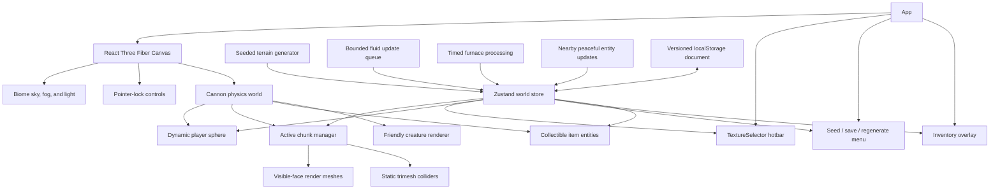

# Codebase Analysis

## Project snapshot

This repository is a browser-based Minecraft-style sandbox built with React and Three.js. It currently supports first-person movement and swimming, chunked seeded terrain, four biomes, caves, ores, vegetation, weather, inventory and crafting, durable tools, persistent furnaces, and peaceful persistent creatures. The player has no health or death state, and the creature system exposes no attack or damage behavior.

The application remains a single Create React App frontend. It has no backend, router, multiplayer service, health/hunger system, or server-authoritative world state.

## Technology stack

| Area | Library | Purpose |
| --- | --- | --- |
| UI and lifecycle | React 18 | Application shell, HUD, menus, and hooks |
| 3D scene | Three.js | Chunk geometry, materials, textures, camera math, sky, and fog |
| React renderer | `@react-three/fiber` | Declarative Three.js scene and frame loop |
| Scene helpers | `@react-three/drei` | Sky and pointer-lock controls |
| Physics | `@react-three/cannon` | Player body and static chunk collision meshes |
| State | Zustand | World chunks, player location, selection, generation, and actions |
| Tooling | Create React App / `react-scripts` 5 | Development server, linting, tests, and production build |

## Architecture



World data is independent from rendered Three.js objects. Blocks are stored in 16 × 16 × 16 chunks, keyed by local voxel index. React components render only chunks within the configured distance from the player's current chunk.

## Source layout

| Path | Responsibility |
| --- | --- |
| `src/App.js` | Composes the environment, controls, physics scene, hotbar, crosshair, and world menu. |
| `src/components/ChunkWorld.js` | Loads active chunks, creates render/collision geometry, and handles voxel breaking and placement. |
| `src/components/WorldEnvironment.js` | Changes sky, fog, and ambient appearance according to the current biome. |
| `src/components/FluidSimulation.js` | Processes a bounded water/lava update queue, with slower lava ticks. |
| `src/components/FurnaceSimulation.js` | Advances placed furnaces on a bounded interval. |
| `src/components/CreatureSimulation.js` | Advances nearby friendly creatures on a bounded interval. |
| `src/components/Creatures.js` | Renders blocky creatures, handles petting, and shows friendship feedback. |
| `src/components/Player.js` | Runs player physics, movement, grounded jumping, chunk tracking, spawning, and fall recovery. |
| `src/components/FPV.js` | Connects pointer-lock controls to the camera and canvas. |
| `src/components/TextureSelector.js` | Renders the hotbar and handles number-key, mouse-wheel, and direct selection. |
| `src/components/Inventory.js` | Renders inventory, player/table crafting, furnace slots, and stack interactions. |
| `src/components/ItemDrops.js` | Renders dropped item entities and schedules attraction, collection, and expiry updates. |
| `src/components/ItemIcon.js` | Provides shared item rendering for inventory and hotbar slots. |
| `src/components/ModelObjects.js` | Caches glTF assets, batches repeated placed objects with instancing, and renders held or dropped model items. |
| `src/components/Menu.js` | Creates seeded worlds, saves them, and regenerates the current seed after confirmation. |
| `src/hooks/useStore.js` | Owns chunk state, generation requests, block mutations, player state, world creation, and persistence actions. |
| `src/hooks/useKeyboard.js` | Tracks movement and jump keys. |
| `src/world/blocks.js` | Defines block IDs, textures, hardness, solidity, transparency, shape, and hotbar availability. |
| `src/world/chunks.js` | Converts world/chunk/local coordinates and performs chunk-keyed block access and updates. |
| `src/world/chunkGeometry.js` | Builds exposed render faces, plant cross meshes, static collision surfaces, and raycast-to-voxel coordinates. |
| `src/world/blockShapes.js` | Defines reusable cuboid parts, rotation, upper/lower placement, and automatic neighbor connections for construction shapes. |
| `src/world/noise.js` | Supplies deterministic seeded random, value-noise, and fractal-noise functions. |
| `src/world/terrain.js` | Generates biome heights, layers, caves, ores, trees, plants, bounds, and safe spawn positions. |
| `src/world/fluids.js` | Queues local fluid updates, applies downward/horizontal flow, limits levels, and handles obsidian reactions. |
| `src/world/playerPhysics.js` | Calculates slowed horizontal and controlled vertical movement in fluids. |
| `src/world/items.js` | Defines inventory items separately from blocks and maps broken blocks to drops. |
| `src/world/inventory.js` | Implements pure stack addition, consumption, movement, merging, splitting, and creative catalog creation. |
| `src/world/crafting.js` | Defines shaped and shapeless recipes and performs normalized grid matching and ingredient consumption. |
| `src/world/mining.js` | Calculates tool mining speed, harvest eligibility, drops, and durability damage. |
| `src/world/furnaces.js` | Defines fuel and smelting recipes and advances persistent furnace state. |
| `src/world/entities.js` | Defines creature types, deterministic spawning, peaceful movement, friendship, gifts, and validation. |
| `src/world/worldStorage.js` | Parses, validates, migrates, serializes, reads, and writes versioned world documents. |
| `src/world/proceduralTextures.js` | Creates pixel-style textures for generated blocks and plants. |

The former `Cube`, `Cubes`, and infinite `Ground` components have been removed. Rendering and physics now operate at chunk level.

## World model

The effective store shape is:

```js
{
  seed,
  chunks: Map<chunkKey, Map<localIndex, blockId>>,
  generatedColumns: Set<columnKey>,
  chunkRevisions: Map<chunkKey, number>,
  fluidLevels: Map<positionKey, number>,
  fluidQueue,
  inventory,
  survivalInventory,
  selectedHotbar,
  gameMode,
  inventoryOpen,
  drops,
  playerCrafting,
  tableCrafting,
  blockEntities,
  station,
  entities,
  spawnedCreatureGroups,
  worldTime,
  activeChunkKeys,
  texture,
  playerPosition,
  playerChunk,
  spawn,
  worldId,
  ensureColumns,
  addCube,
  removeCube,
  getBlock,
  processFluidStep,
  selectHotbar,
  setInventory,
  updateDrops,
  setGameMode,
  craftItem,
  openBlockInterface,
  processFurnaces,
  updateCreatures,
  interactCreature,
  setTexture,
  setPlayerPosition,
  saveWorld,
  createWorld,
  resetWorld
}
```

Chunk and local coordinate helpers use floor-based division, so negative world positions map correctly. A block mutation clones only its containing chunk and increments revisions for that chunk and any neighbor affected by a boundary face.

## Terrain generation

Text seeds are hashed into stable 32-bit values. Layered 2D noise controls temperature, moisture, broad elevation, and local detail. These fields select plains, forest, desert, or mountain terrain and determine surface height.

Each generated column contains:

- Bedrock at the minimum height
- Grass or exposed mountain stone at most surfaces
- Sand layers in deserts
- Dirt below grass
- Stone at depth
- Connected cave voids from layered 3D noise
- Depth-limited coal and iron veins
- Forest trees with trunks and leaf canopies
- Non-solid tall grass and flowers
- Sparse seeded lakes with sand beds and a stable water level

Tree origins are evaluated beyond each column edge, allowing canopies to cross chunk boundaries deterministically. The spawn search avoids mountains and nearby tree trunks. Falling below the world returns the player to that safe spawn.

## Rendering and physics

`ChunkWorld` renders only active chunk columns around the player. Geometry generation omits faces between neighboring opaque blocks and groups remaining faces by material. Plants use crossed, double-sided planes. A block change rebuilds its chunk and a neighboring chunk only when the edited voxel touches a chunk boundary.

Solid exposed surfaces are also combined into one static Cannon trimesh per rendered chunk. Fluids are transparent non-solid volumes with lowered top surfaces and hidden internal faces. The player remains a single dynamic sphere. Grounded jumping checks the solid voxel below the player, while water and lava apply slower horizontal motion, limited falling speed, and vertical swimming controls.

The bounded fluid engine supports downward and horizontal propagation, different water/lava ranges, and obsidian reactions. Generated lakes and manually placed fluid cubes stay static during normal play, so placing one water or lava cube creates exactly one cube. Lava changes visibility and movement but does not damage or reset the player.

The environment advances through a six-minute day/night cycle. Biome colors blend into night lighting, underwater and lava fog override the normal atmosphere, and deterministic weather periods create rain in plains/forests or snow in mountains.

In survival mode, broken collectible blocks create item entities that expire after five minutes. Drops within five blocks move toward the player and merge into the 36-slot inventory on contact. The first nine slots form the hotbar. Every world receives the registered block catalog as an unlimited building palette, so successful placement does not consume items. Creative mode additionally breaks blocks instantly.

The inventory includes a categorized creative-style catalog for blocks, windows, doors, utility objects, nature, fluids, materials, tools, and friendly creatures. Water and lava have a dedicated Fluids category, and every catalog tile includes a visible item name. Catalog entries can restore any removed item stack, while a trash target permanently clears held or dragged stacks from the 36 storage slots. Creature catalog items place persistent friendly entities and are never used for hostile spawning.

World blocks now use a reproducible hybrid art pipeline. Seventy-nine game-ready 128 × 128 faces combine derived CC0 sources with scripted project art, alongside 38 item and model-preview illustrations. A build script creates padded power-of-two atlases for opaque, cutout, translucent, and emissive layers. Chunk workers select atlas UVs per face, rotate directional fronts with placed block state, and group geometry by render layer. Inventory, hotbar, held blocks, and item drops reuse the same atlas definitions. The first decorative collection adds gravel, snow, ice, red and gray brick, mossy and polished stone, red and pale planks, pale logs, and cactus without changing existing block IDs.

Terrain and ore surfaces select deterministic warm or cool variants from the world seed and voxel position. Mesh workers add directional vertex shading and biome colors for grass, leaves, and water without multiplying atlas textures. Fluid, portal, and powered-lamp materials animate at a low rate through safe movement inside atlas padding; emissive layers pulse gently. Breaking outlines use the selected block's actual construction parts or model collision bounds, and material roughness follows the opaque, translucent, and emissive render layers.

House-building pieces include one-voxel framed windows with translucent panes and coordinated wooden doors that occupy two vertical voxels. Door halves share orientation and open state, opened doors release the full doorway for the player's one-block-wide collider, occupied upper space prevents placement, and breaking either half removes the complete structure with one drop. Windows and Doors each have a dedicated catalog category.

Construction blocks use reusable cuboid parts in the chunk worker. Slabs and stairs support upper or lower placement, stairs and beams rotate toward the camera, and fences, walls, and railings inspect adjacent blocks to build their connections. Posts, torches, and lanterns use the same shape path. Render surfaces, collision triangles, item previews, held objects, and drops all derive from these definitions.

Sparse decorations use twenty generated embedded glTF assets: chairs, stools, tables, shelves, cabinets, barrels, crates, baskets, planters, lights, rugs, wall art, rocks, bushes, fallen logs, signs, benches, and path markers. The loader caches geometry, active objects of each type share one instanced draw call, and the chunk worker emits only their simple collision bounds. Model definitions retain scale, footprint, orientation, light, and interaction-point metadata. Their inventory thumbnails are projected from the same source cuboids, and held and dropped objects use the loaded geometry.

Crafting recipes are data-driven and support shaped or shapeless matching. The inventory exposes a 2 × 2 grid, while a placed crafting table opens a 3 × 3 grid. Wooden and stone tools accelerate their matching block categories, harvest tiers control stone and ore drops, and successful survival mining reduces tool durability.

Placed furnaces own block-entity state for input, fuel, output, remaining burn time, and cook progress. Coal, logs, and planks provide fuel; current recipes smelt iron ore into ingots and sand into glass. A scheduler advances furnaces even when their interface is closed.

Creature groups spawn deterministically per chunk column. Sheep favor plains and forests, rabbits appear in dry and mountain terrain, and glow sprites appear during nighttime periods. Nearby wild creatures wander and avoid steep terrain, obstacles, and water. Petting makes an entity persistent, increases friendship, shows heart feedback, grants cooldown-limited gifts, and starts calm following with personal space. No code path lets creatures attack, flee from, damage, or be damaged by the player.

The player intentionally has no health, hunger, oxygen damage, death, or combat state. Lava changes movement and atmosphere without causing damage. Falling below the world triggers position recovery solely to prevent the player from becoming stuck.

The default render distance is Ultra: four chunk columns in every horizontal direction, producing a 9 × 9 active area of 81 columns. The menu offers persisted distances from 1 through 4. Terrain, structures, and generated-column lighting run in a background Web Worker, while a second worker builds visual and collision mesh buffers. Columns are prioritized nearest-first. Completed meshes are installed at most once per animation frame, and an existing mesh stays active until its replacement is ready. Previously visible columns remain rendered until the new footprint is complete, while stale generation results are ignored after the player changes chunks or worlds. Generated chunk data remains in memory when its meshes unload. Synchronous compatibility paths preserve behavior where Web Workers are unavailable.

Compatible opaque faces are greedily merged in the mesh worker when their direction, atlas region, biome tint, collision boundary, and lighting shade match. Per-vertex tile coordinates repeat the original atlas face once per block across a merged rectangle. Partial, cutout, emissive, fluid, and translucent geometry stays unmerged; translucent blocks are split into stable block and animation batches and rendered after opaque geometry. The F3 overlay samples frame average and p95, renderer calls and triangles, geometry and texture allocations, estimated active buffer memory, worker and install p95, render layers, and instanced model categories. It retains distance 2 and 4 readings for comparison with documented budgets.

## Persistence

World documents use version `8`. A catalog stores independent world metadata and one document per world ID. Existing single-world saves migrate into the default catalog entry. Version 7 and older saves adopt the new Ultra view-distance default once; choices saved in version 8 persist normally. Documents include dimension snapshots, exploration, markers, goals, game rules, data-pack requirements, Phase 9 block state, and all earlier terrain, inventory, crafting, furnace, chest, crop, and creature state. Worlds can be duplicated, exported, imported after validation, and deleted.

The loader still accepts versions 2 through 7 and the earlier flat `cubes` array. Storage remains explicit: the player must choose Save. Regenerate rebuilds the current world ID, while the Worlds interface creates and switches independent saves.

## Advanced single-player systems

Explored chunk columns, biome discoveries, map markers, structures, and peaceful goals persist with each world. The F3 overlay reports coordinates, chunk, biome, dimension, voxel light, time, and active chunks. The map reveals an 11 × 11 window around the player only as its chunks are visited.

Structure placement is seeded by chunk coordinate and independent of load order. The Overworld now includes sparse biome-aware houses alongside ruins, camps, and wells, while the Dream Grove retains crystal gardens. Houses occupy at most one candidate column per 4 × 4 chunk region, reject lakes and steep sites, and adapt their foundation, walls, framing, and roof to plains, forest, desert, or mountain terrain. Each house includes working doors, framed windows, lighting, furniture, a chimney, a short path, and outdoor decoration.

Rarer regional landmarks use a separate 7 × 7 chunk spacing grid. Four-floor hotels include furnished guest levels, balconies, climbable floor and roof access, a reception area, rooftop lighting, landscaping, and an outdoor two-block-deep swimming pool. Five-floor residential buildings include broad window patterns, alternating balconies, furnished levels, roof access, and a decorated entrance plaza. Both reject wet or excessively steep sites, use biome-specific materials, and remain inside one horizontal chunk column so later terrain streaming cannot overwrite part of a structure. Copper, gold, and crystal resources extend underground progression. An enchanting table applies mining-efficiency and durability enchantments without adding combat.

Portal interaction switches between independently stored Overworld and Dream Grove chunk state. Inventory and progression remain world-level, and a return portal is created for a new destination. The Dream Grove uses its own terrain seed and environment styling.

Version-1 JSON data packs validate namespaces, limits, block identifiers, colors, and recipes before mutating the runtime registries. Custom blocks receive generated textures and matching inventory items. Packs persist separately so their IDs are registered before a saved world is parsed.

## Current controls

| Input | Behavior |
| --- | --- |
| Click canvas | Acquire pointer lock |
| W / A / S / D | Move relative to camera direction |
| Space | Jump while grounded |
| Space / Shift while submerged | Swim upward / downward |
| 1–9 | Select a hotbar slot |
| Mouse wheel | Cycle the hotbar |
| E | Open or close the inventory and release pointer lock |
| F3 | Toggle coordinates and debug information |
| M | Toggle the exploration map, markers, discoveries, and goals |
| Left-click | Place the selected block or use the selected placement item |
| Short right-click | Use storage, utility, portal, farming, or crafting blocks |
| Right-click and hold | Break the targeted block according to hardness |
| Either click on creature | Pet and befriend the creature |
| Escape | Release pointer lock |

Interaction is limited to six world units. Placement rejects occupied coordinates, positions inside the player collider, bedrock/below-world positions, and positions above the maximum build height.

## Build health

`npm run build` succeeds without application lint warnings. The latest production output is approximately 466.8 kB of main JavaScript and 3.21 kB of CSS after gzip, plus small separately loaded worker chunks and five cached atlas images totaling about 372 kB. The toolchain still reports outdated Browserslist data and a Node deprecation notice for `fs.F_OK`.

The project has 131 passing tests across twenty-four suites. Coverage includes block, item, model, variant, tint, and animation metadata; vertex shading; greedy face reduction and atlas tiling; transparent batch separation; performance aggregation and budgets; shaped-object previews, drops, and bounds; functional-block face sets; model collision isolation; decorative catalog grouping; slabs and directional stairs; connected construction shapes and collision; placement-state persistence; face selection; directional texture rotation; worker-compatible terrain and mesh generation; streamed terrain transitions; render-distance selection and persistence; two-block door placement, removal, and open-door clearance; window and door catalog separation; categorized catalog restoration; inventory deletion; friendly creature placement; world catalogs and import/export; deterministic houses, hotels, pools, tall buildings, landmark spacing, and structure streaming safety; validated data packs; isolated dimensions; enchantments; Phase 9 interactions; creatures; recipes; mining; furnaces; inventory; chunks; lighting; fluids; terrain; physics; version 8 persistence; and older save migration.

## Remaining risks and next work

- GPU buffer creation and physics-body installation must occur on the main thread, but completed worker meshes are applied at most once per frame and their cost is visible in F3 diagnostics.
- Full generated chunks are stored in `localStorage`. Long exploration sessions can exceed its quota; IndexedDB remains the next persistence upgrade.
- Collision meshes are rebuilt with visual geometry in the mesh worker. Profiling is needed before increasing chunk density beyond the current Ultra setting.
- Browser-level interaction, WebGL rendering, and physics behavior still require the documented manual visual-quality review in addition to automated tests.
- Translucent block types are separated and object-sorted, but intersecting transparent faces inside one block batch can still show the limits of standard alpha blending.
- Fluid simulation currently spreads and reacts but does not recede after a source is removed.
- Weather particles are visual only and do not yet affect block state or player behavior.
- Dropped items use lightweight visual entities without terrain collision or bounce physics.
- Accessibility and touch controls remain unimplemented.

## Development commands

```bash
npm install
npm run assets:validate
npm start
CI=true npm test -- --watch=false
npm run build
```
